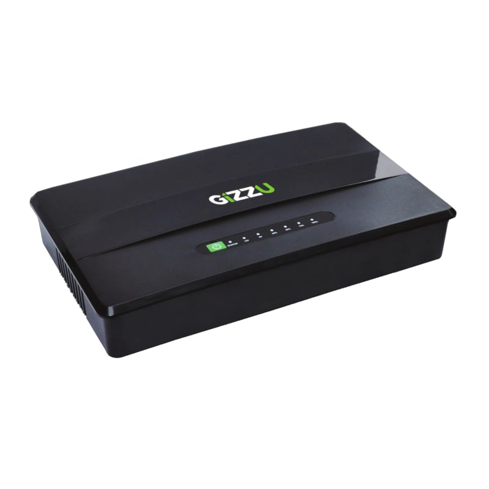
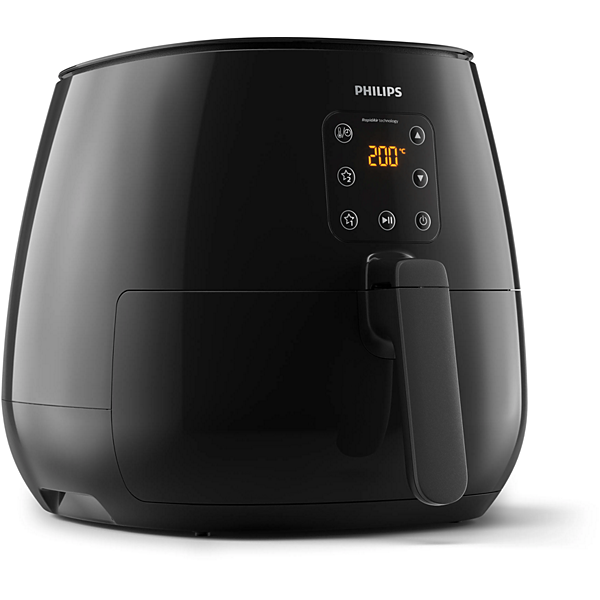
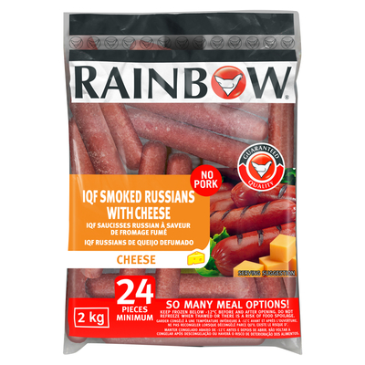
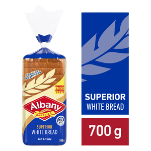
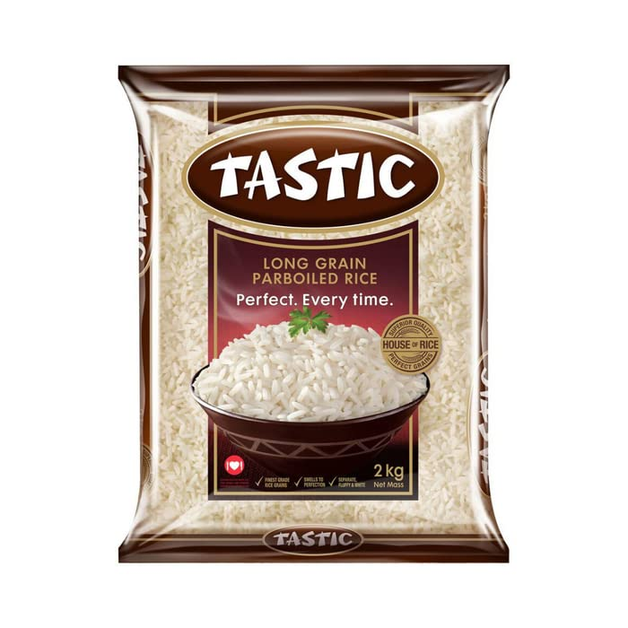
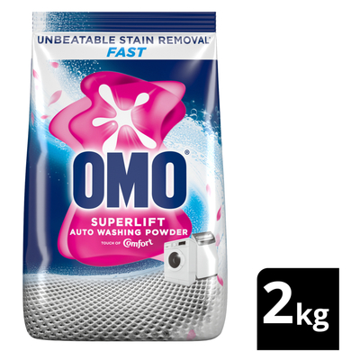
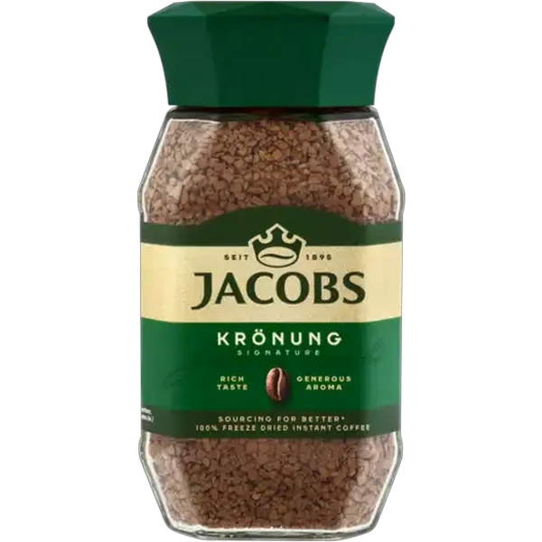
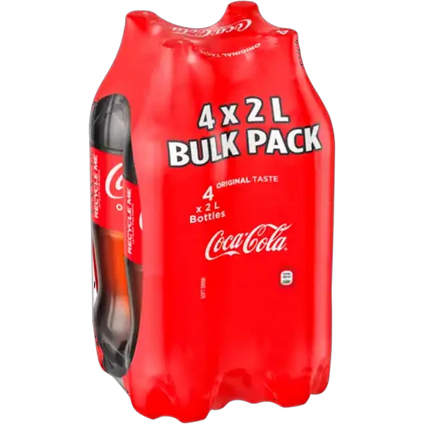

# DealHunterSmart

South African price-comparison web app by **Lawrence Tshabalala**.

DealHunterSmart is a full-stack demo for comparing grocery, household, baby, kitchen, electronics, and load-shedding prices in South African rand. A shopper searches a seeded catalog, sees shelf prices next to loyalty prices, builds a basket, and checks delivery fees for a chosen suburb. A keyword assistant answers a fixed set of shopping questions from the same catalog.

The running app keeps its data in memory. Retailer names, prices, loyalty labels, and suburb coverage are authored in the repository. They are sample data for the interface, and they are separate from live retailer systems.

## Features

- **Catalog search and categories.** Twelve products in five categories: Groceries & Braai, Load Shedding & Power, Electronics & Tech, Home & Kitchen, and Baby & Health. Search matches name, description, brand, and feature text.
- **Per-store price rows.** Thirty-nine seeded listings across Checkers Sixty60, Pick n Pay asap!, Woolworths Dash, Makro, Takealot, Amazon.co.za, Incredible Connection, HiFi Corp, Dis-Chem, and Clicks. Each row can carry a regular price, a loyalty price, a loyalty label (Xtra Savings, Smart Shopper, WRewards, mCard, ClubCard, Dis-Chem Benefit, and similar labels in the seed data), delivery speed, stock, and an outbound product URL.
- **Product detail.** The page ranks stores by the lower of loyalty price and shelf price, highlights the cheapest row, and can add the product to the basket or wishlist.
- **Smart basket.** Items and quantities persist in the browser. Totals are calculated for Checkers Sixty60, Pick n Pay asap!, Woolworths Dash, Takealot, and Makro, including loyalty savings and the suburb delivery fee. Takealot’s fee in this calculation drops to R0 when the matched subtotal is at least R500. A two-store split compares Checkers Sixty60 with Pick n Pay asap! when both stores can take at least one basket line.
- **Wishlist and price alerts.** Saved products and alert targets persist in `localStorage`. Saving an alert also POSTs it to an in-memory server map. The alert form can open WhatsApp with a prefilled message.
- **Suburb delivery checker.** Twelve authored suburbs (Sandton, Rosebank, Fourways, Cape Town CBD, Sea Point, Umhlanga, Centurion, Soweto, Stellenbosch, Pretoria East / Menlyn, Durban North, and Gqeberha). Each suburb lists availability, service type, estimated time, fee, cutoff, hours, and hub for Checkers Sixty60, Pick n Pay asap!, Woolworths Dash, Takealot, Amazon.co.za, Makro, and Dis-Chem DeliverD. The header suburb defaults to Sandton (2196) and is remembered in the browser.
- **Deal assistant.** `POST /api/ai/chat` matches keywords (braai, load shedding and power, cooking oil, air fryer, nappies, TV, plus a name/brand fallback) and returns a templated reply, suggested products, and follow-up prompts. Chat history is accepted by the handler and left unused.
- **Basket share.** The basket page opens `https://wa.me/` with a prefilled summary of items, suburb, and the cheapest complete store total.
- **Responsive shell.** Desktop header navigation and a fixed mobile bottom bar. Prices use `en-ZA` currency formatting shown as `R`.

## Tech stack

What the running app uses:

| Layer | Choice |
| --- | --- |
| UI | React 18, Vite 5, Wouter, TanStack Query v5, Tailwind CSS 3, Radix UI via the shadcn/ui components in `client/src/components/ui` |
| API | Express 4, TypeScript, `tsx` in development, esbuild for the production server bundle |
| Data at runtime | In-memory `MemStorage` maps, seeded from `server/data/mockData.ts` |
| Shared types | Drizzle table definitions and Zod insert schemas in `shared/schema.ts` |
| Client state | React context plus `localStorage` for basket, wishlist, alerts, and selected suburb |

Also present in the repo, and unused by the request path today: a Drizzle Kit config aimed at PostgreSQL (`DATABASE_URL`), and npm dependencies for Neon, Passport, and Express sessions. `npm run db:push` is the only script that reads `DATABASE_URL`. The server never opens a database connection.

## Repository layout

```
client/                 React app (Vite root)
  public/images/products/   Catalog images
  src/pages/            Home, search, product, basket, wishlist, delivery checker
  src/components/       Product, price, basket, assistant, and delivery UI
  src/lib/              Query client, basket, wishlist, delivery, ZAR formatting
server/
  index.ts              Express entry; Vite middleware in development
  routes.ts             /api routes
  storage.ts            In-memory storage
  data/mockData.ts      Seeded categories, products, and store prices
  aiAssistant.ts        Keyword deal replies
  services/liveStoreScraper.ts
shared/
  schema.ts             Drizzle/Zod models for users, categories, products, stores
  deliveryData.ts       Suburb coverage used by the API
```

The client keeps its own copy of the suburb data in `client/src/lib/deliveryData.ts`. The API reads `shared/deliveryData.ts`.

## Quick start

Requirements: Node.js 20 or newer and npm. This repo was typechecked with the Node 20 type definitions in `package.json`.

```bash
git clone https://github.com/Lawrence-Flash/DealHunterSmart.git
cd DealHunterSmart
npm install
npm run dev
```

The dev server listens on `0.0.0.0` and port **5000**, or `PORT` when that variable is set. Open [http://localhost:5000](http://localhost:5000). In development, Express mounts the Vite dev server, so the UI and `/api` share one origin.

Other scripts:

| Script | What it does |
| --- | --- |
| `npm run check` | TypeScript check (`tsc`, no emit) |
| `npm run build` | Vite client build to `dist/public`, then esbuild the server to `dist/index.js` |
| `npm run start` | Run the production bundle (`node dist/index.js`), which serves `dist/public` |
| `npm run db:push` | `drizzle-kit push`. Requires `DATABASE_URL`. It does not change the in-memory catalog the app serves |

There is no test script.

## Usage

### Pages

| Path | What you can do |
| --- | --- |
| `/` | Search, category chips, featured comparison, and shortcuts that open the assistant |
| `/search` | Filter the loaded catalog by `q` and `category` query params |
| `/product/:id` | Compare store rows, save, alert, add to basket, and call live-sync for that product |
| `/basket` | Quantities, per-retailer totals, two-store split, WhatsApp share |
| `/wishlist` | Saved products, alert list, and the largest seeded shelf-vs-loyalty gaps |
| `/delivery-checker` | Search suburbs or postal codes and read coverage, fees, and hubs |

The home page also renders static marketing blocks (a savings callout, three testimonials, and App Store / Google Play buttons). Those blocks are copy in the components. The store buttons have no download URLs.

### API

| Method | Path | Behavior |
| --- | --- | --- |
| `GET` | `/api/products` | All products |
| `GET` | `/api/products/:id` | One product, or 404 |
| `GET` | `/api/products/:id/stores` | Price rows for that product |
| `GET` | `/api/categories` | All categories |
| `GET` | `/api/categories/:slug` | One category, or 404 |
| `GET` | `/api/stores` | All price rows |
| `GET` | `/api/search?q=&category=` | Server-side name, description, and brand filter. The search page filters in the browser and does not call this route |
| `POST` | `/api/ai/chat` | Body `{ message, history }`. Keyword reply from the seeded catalog |
| `GET` | `/api/live-sync/status` | Hard-coded retailer status payload plus the last in-process sync time |
| `POST` | `/api/live-sync/:productId` | Adjusts that product’s seeded prices in memory |
| `POST` | `/api/live-sync/all` | Runs the same adjustment for every product |
| `GET` | `/api/alerts` | Alerts held in the server process |
| `POST` | `/api/alerts` | Stores an alert in that process map |
| `POST` | `/api/alerts/test-notify` | Returns `status: "simulated_success"` and a message string |
| `GET` | `/api/delivery/suburbs` | The twelve suburbs |
| `GET` | `/api/delivery/coverage?postalCode=&suburb=` | First matching suburb, otherwise the first suburb in the list |

Restarting the server clears products, prices, and server-side alerts. Browser `localStorage` keeps the basket, wishlist, alerts, and suburb.

## Images

The repository has no screenshots of the running UI. Catalog photos live in `client/public/images/products/`:

| | | |
| --- | --- | --- |
|  |  |  |
| Sunfoil oil | Gizzu UPS | Philips air fryer |
|  |  |  |
| Samsung TV | Pampers | Rainbow chicken |
|  |  |  |
| Clover milk | Albany bread | Tastic rice |
|  |  |  |
| OMO Auto | Jacobs coffee | Coca-Cola |

`generated-icon.png` at the repository root is a standalone icon file and is not wired into `client/index.html`.

## Limitations

- The catalog is twelve products and thirty-nine price rows. Adding a product means editing the seed data (or calling the unused `createProduct` / `createStore` storage methods; no public write API exposes them).
- Live sync applies a small random change to the in-memory price (about one rand, and only on some calls). It does not fetch retailer websites or APIs. The status payload’s latency figures are constants in `liveStoreScraper.ts`.
- The assistant is a keyword template over the seed catalog. The load-shedding branch looks up category slug `loadshedding`, while the seed slug is `load-shedding`, so that reply can omit the product card.
- Some navigation links use slugs that differ from the seed data: Groceries uses `groceries` (seed slug `groceries-braai`) and the mobile Power tab uses `loadshedding` (seed slug `load-shedding`). The mobile Account tab routes to `/search`.
- Price-alert channels (WhatsApp, email, browser) are labels on a saved record. The test-notify route returns a simulated payload and sends nothing. WhatsApp actions open a `wa.me` draft.
- User accounts are sketched only. `shared/schema.ts` has a `users` table and `MemStorage` can create a user, and the npm tree includes Passport. No route registers, logs in, or authorizes anyone.
- Suburb coverage is a static list of twelve places, duplicated between `shared/deliveryData.ts` and `client/src/lib/deliveryData.ts`.
- The home-page savings figure and testimonials are hard-coded strings.
- There is no automated test suite.

## Roadmap

Next steps that follow from the code as it stands:

1. Persist categories, products, stores, and alerts with the existing Drizzle schema and a real `DATABASE_URL`, and have `storage.ts` read that database.
2. Replace the random price adjustment with a real retailer feed, and show the timestamp that feed returns.
3. Point category links at `groceries-braai` and `load-shedding`, and align the assistant’s load-shedding lookup with that slug.
4. Send alerts through a real channel, or label the current flow as a local reminder only.
5. Use chat history, or connect the assistant to a model with the catalog passed in as context.
6. Add auth routes for the existing user schema, or remove the unused Passport dependencies.
7. Keep one suburb dataset and import it from both the API and the client.
8. Add tests for price ranking, basket totals, delivery-fee thresholds, and search filtering.
9. Replace the App Store and Google Play buttons with a link to this web app, or remove them until a mobile build exists.

## License

`package.json` sets `"license": "MIT"`. The repository has no separate `LICENSE` file.
